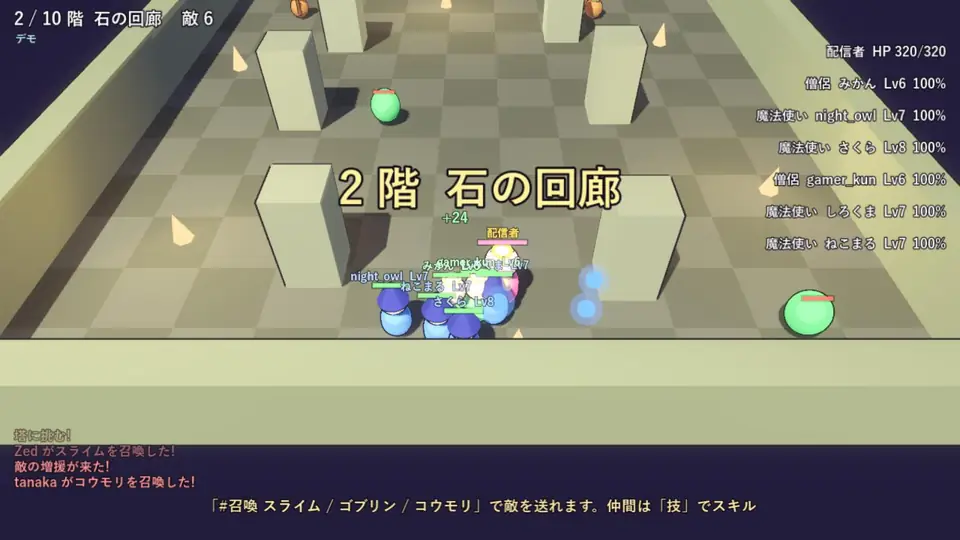

# StreamRaid

配信者が自分のアバターで「しじまの塔」を登り、視聴者がコメントで仲間・敵・番人への攻撃として参加するアクション RPG です(開発中)。

*自動プレイのデモ(仲間・召喚・技はすべてテスト用のコメントです)*

## ダウンロード

[Releases](../../releases/latest) から `StreamRaid-vX.Y.Z.zip` をダウンロードして展開し、`StreamRaid.exe` を起動してください(Windows 10 / 11)。
新しいバージョンが出ると画面に表示され、F10 → その他 →「今すぐ更新」で更新できます(署名を確認した更新だけを適用します)。
コード署名をしていないため、初回は「Windows によって PC が保護されました」と出ることがあります(「詳細情報」→「実行」)。

## 物語「しじまの塔」

ある夜、町はずれに現れた塔が、毎晩だれかの声を盗んでいく。てっぺんの「始まりの鐘」を鳴らせば、盗まれた声は戻ってくる——。
声を力に変えられるのは、たくさんの人に声が届く配信者だけ。視聴者のコメント(声)が、塔の中では仲間や攻撃になります。

- 塔は 5 つの階層(石の回廊 / 嘆きの書庫 / 鏡の庭 / 凍える鐘楼 / しじまの玉座)、全 100 階
- **5 階ごとに番人**(全 20 体)。戦う前に塔の「習わし」や昔話を語り、物語が少しずつ明かされます
- 上の階ほど雑魚は硬く、番人は手ごわくなります
- 予告の出ない技にも合図があります。何度か挑むうちに見えてくるはず
- 配信画面の**左下・右下は空けてあります**(VTuber の立ち絵用)。番人の攻撃や予兆、召喚された敵はそこに出ません。バトルログは設定で左下・右下を選べます
- **番人を倒すたびに記録**され、次は「続きから」登れます(参加受付で Enter = 続きから / F8 = 1 階から)
- 仲間のレベルは配信をまたいで成長するので、何度も参加するほど上の階に挑めます
- 100 階を登りきると、一緒に戦った視聴者の名前がスタッフロールで流れます

## 1 回の流れ

1. **参加受付** — 「#参加 戦士 / 魔法使い / 僧侶」とコメントすると仲間になる
2. **塔を登る** — 仲間は自動で戦い、「技」でスキル。「#召喚 スライム / ゴブリン / コウモリ」で視聴者が敵を送り込める
3. **番人の間(5 階ごと)** — 会話のあと戦闘。コメントするたびに番人へ攻撃が飛ぶ。投げ銭は必殺技
4. **結果発表** — 登った階・倒した番人、MVP・ダメージランキング・いちばん邪魔した人・レベルアップ

## 設定(F10)

初回は自動で開きます。ダンジョン・ボス戦の途中で開くとゲームは一時停止し、参加受付中は受付時間だけ止まります。

| タブ | できること |
| --- | --- |
| 接続 | 配信者の名前、アバター(VRM)、YouTube(チャンネル or 配信の URL)、Twitch。ログイン不要 |
| ゲーム | 塔の最上階(20〜100 階、5 刻み)、参加受付の時間、仲間の最大人数、難しさ |
| コメント | ボス戦の攻撃の間隔(連投対策)、召喚のオン・オフと間隔、投げ銭の必殺技、仲間をメンバー限定に、コメントを無視する人 |
| その他 | テスト用キーの説明の表示、バトルログの位置(左下 / 右下)、効果音の音量、アップデート、作った人、視聴者の記録を消す |

YouTube は CommentDeck と同じく、YouTube のチャット画面と同じ仕組みでコメントを読み込みます。

## 配信者のアバター(VRM)

接続設定(F10)の「VRM を選ぶ…」で、VRoid などで作った VRM(0.x / 1.0)を配信者のキャラにできます。
VRM にはアニメーションが入っていないので、立ち・歩き・攻撃は骨を動かして付けています。

## 操作

| | キーボード / マウス | ゲームパッド |
| --- | --- | --- |
| 移動 | WASD / 矢印 | 左スティック |
| 攻撃 | J / 左クリック | X |
| 回避(無敵あり) | Space / K / 右クリック | A |
| 出発・もう一度 | Enter | Start |
| 設定 | F10 | |

テスト用のコメント: F1 参加 / F2 召喚 / F3 コメント / F4 投げ銭 / F5 技 / F6 コメント 20 件

## 開発

- Godot 4.7(.NET 版)+ C#。`play.bat` で起動、`demo.bat` で自動デモ
- `v*` のタグを push すると GitHub Actions が書き出して Releases に公開します(Secret: `UPDATE_SIGNING_KEY` = 更新署名用の RSA 秘密鍵 XML を base64 にしたもの)
- アイコンは `tools/make-icon.ps1` で生成
- `dotnet build` でビルド
- 視聴者の記録は `user://viewers/<チャンネル>.json`、塔の進み具合は `user://progress/<チャンネル>.json`、設定は `user://settings.json`(この PC の中だけ)
- 開発用の起動オプション: `--demo`(自動プレイ)、`--start-floor=N`(N 階から)、`--invincible`、`--credits-test`
- コメント取得だけの確認: `godot --headless --path . -- --chattest --yt=@チャンネル --tw=チャンネル --seconds=40`

## 作者

[りんのゲーム部屋(@linn__t_games)](https://www.youtube.com/@linn__t_games)

## ライセンス

[GNU General Public License v3.0](LICENSE)(GPL-3.0)

**改造して配布する場合も、作者表記(りんのゲーム部屋)を残してください。**
(GPL-3.0 第 7 条 b 項にもとづく追加条項: ゲーム内の作者表記 —— 参加受付の画面、エンディングの「制作」、設定の「作った人」—— と、この README の作者表記を残すこと)

### 同梱しているもの

- [godot-vrm](https://github.com/V-Sekai/godot-vrm)(`addons/vrm`、MIT License)— VRM の読み込み。実行中の読み込み(Godot 4.7)で向きの変換が効かない部分を直しています(変更箇所に `StreamRaid:` のコメント)
- [Godot-MToon-Shader](https://github.com/V-Sekai/godot-vrm)(`addons/Godot-MToon-Shader`、MIT License)— VRM のアニメ調の見た目
